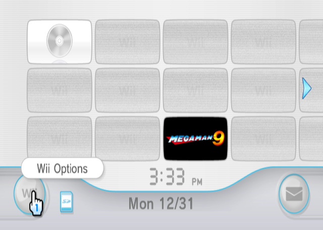
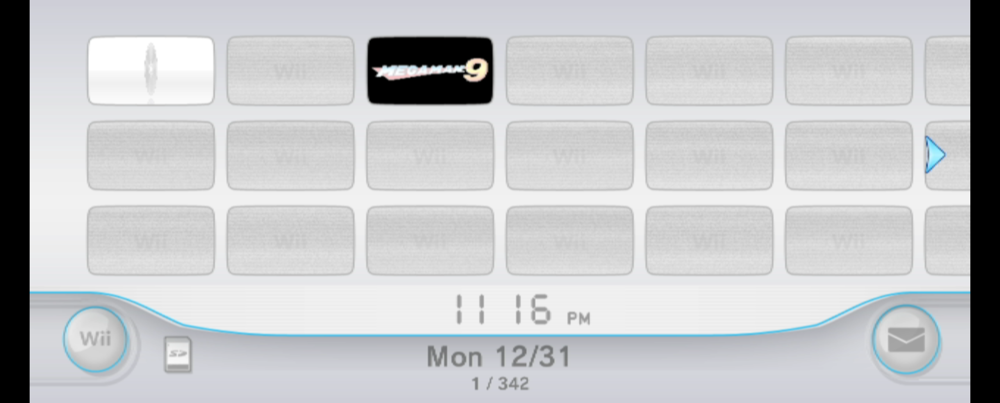

# wiillr

Shared Wii runtime and static recompilation tools.

[Wii Menu Recomp](https://github.com/mstan/wii-menu-recomp) is a separate
application repository that pins wiillr as a submodule. Its adaptive layout,
product configuration, platform build scripts and packaging belong to that
consumer.

| Product | Start here |
| --- | --- |
| **Wii Menu Recomp** | [Application repository and releases](https://github.com/mstan/wii-menu-recomp) |
| **wiillr developer tools** | [Inspection, discovery and native code preparation](docs/developer-tools.md) |

Wii Menu imports your own supported Wii Menu 4.3U NAND backup or extracted
system folder. The application includes no original system or channel content.

Fresh settings use widescreen **Fit to screen**. The Wii Menu launcher includes
four Wii Remote assignments and **Wii Peripherals** for USB 1, USB 2 and SD Card.

The Menu consumer offers optional **Adaptive channel grid** and **Expanded
channel library** mods. Adaptive Fit keeps three rows, varies from two to six
columns and caps the viewport at 21:9; wider windows retain their size with side
margins. Expanded libraries offer 2x through 128x the stock 48 positions, with a
Wii-style page counter that recalculates as the window changes. Library ordering
persists separately from native saves. See the consumer's
[library guide](https://github.com/mstan/wii-menu-recomp/blob/main/docs/channel-library.md)
for setup and limits.

## Builds and downloads

[Wii Menu releases](https://github.com/mstan/wii-menu-recomp/releases) live with
the consumer. The engine's [developer-tool releases](https://github.com/mstan/wiillr/releases)
retain developer tools and earlier application packages. [Build instructions](docs/building.md)
cover Windows, Linux and macOS through the shared driver and platform scripts;
use the consumer's scripts for new Wii Menu builds.
Consult each release's notes for its actual platform validation and limitations.
The current Windows previews are [Wii Menu Recomp 0.1.4](https://github.com/mstan/wii-menu-recomp/releases/tag/v0.1.4)
and [wiillr developer tools 0.1.2](https://github.com/mstan/wiillr/releases/tag/wiillr-v0.1.2).

Build flags are for compiling from source. The [argument and input reference](docs/building.md#build-arguments)
explains product names, package versions and build bundles. To use a downloaded
application or developer bundle, follow its setup guide instead.

The developer tools build without a title catalog. Native game builds require
qualified generated PowerPC inputs supplied privately; firmware, keys, NAND,
generated guest code and user saves are never committed to this repository.

## Development status

The packaged native providers and their qualified title routes are distinct
from development discovery and original-IOS LLE. Discovery reports interpreted
execution and misses explicitly. Accepted native routes require zero interpreted
instructions and unresolved native misses. Original Startup Menu/IOS4, retail
4.3U and arbitrary Wii title compatibility are separate targets. Wind Waker
engineering remains deferred.

[Wii Menu source and annotation references](docs/wii-menu-references.md) collect
the versioned decompilation, symbols and system-format documentation.

[Native runtime reference](docs/native-runtime.md) documents provider selections,
debug commands, preparation and renderer contracts. Save states are specific to
their build; original native saves and imported assets are preserved.

The native runtime, generators and build scripts use [GPLv3 or later](LICENSE).
The independent Menu annotation helper uses PolyForm Noncommercial 1.0.0.
[Licensing details](LICENSING.md) define that narrow exception and preserve
third-party licenses and earlier grants. Component notices and corresponding
source accompany applicable distributions.
wiillr is independent software and is not affiliated with Nintendo or Capcom.
