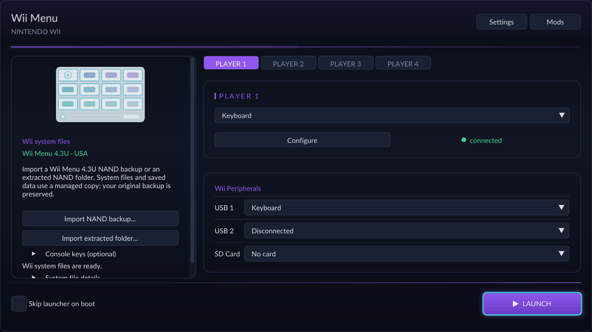
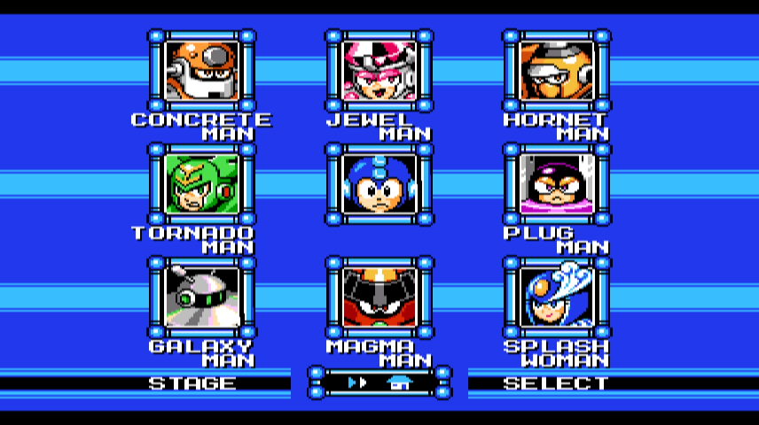

# wiillr

Wii static recompilation tools and native desktop applications.

| Product | Start here |
| --- | --- |
| **Wii Menu Recomp** | [System import, controls and peripherals](docs/wii-menu.md) |
| **Mega Man 9 Recomp** | [Game/DLC import, display settings and mods](docs/mega-man-9.md) |
| **wiillr developer tools** | [Inspection, discovery and native code preparation](docs/developer-tools.md) |

Wii Menu and Mega Man 9 are separate applications with separate launcher
settings. Wii Menu imports your own supported Wii Menu 4.3U NAND backup or
extracted system folder. Mega Man 9 imports your own supported USA WAD and
optional DLC. Neither includes original system or game content.

Fresh settings use widescreen **Fit to screen**. The Wii Menu launcher includes
four Wii Remote assignments and **Wii Peripherals** for USB 1, USB 2 and SD Card.
Game-specific mods stay in the Mega Man 9 launcher.

| Wii Menu | Mega Man 9 |
| --- | --- |
|  |  |

## Builds and downloads

[Private releases](https://github.com/mstan/wiillr/releases) contain separately
versioned application and developer-tool packages. [Build instructions](docs/building.md)
cover Windows, Linux and macOS through a shared driver and platform scripts.
Consult each release's notes for its actual platform validation and limitations.

The developer tools build without a title catalog. Native game builds require
qualified generated PowerPC inputs supplied privately; firmware, keys, NAND,
generated guest code and user saves are never committed to this repository.

## Development status

The packaged native providers and their qualified title routes are distinct
from development discovery and original-IOS LLE. Discovery reports interpreted
execution and misses explicitly. Accepted native routes require zero interpreted
instructions and unresolved native misses. Original Startup Menu/IOS4, retail
4.3U and arbitrary Wii title compatibility are separate targets. Wind Waker
engineering remains deferred.

[Wii Menu source and annotation references](docs/wii-menu-references.md) collect
the versioned decompilation, symbols and system-format documentation.

[Native runtime reference](docs/native-runtime.md) documents provider selections,
debug commands, preparation and renderer contracts. Save states are specific to
their build; original native saves and imported assets are preserved.

Original wiillr code is MIT. Shared components and adapted third-party code
retain their licenses and notices. See [LICENSE](LICENSE), `third_party/`,
component repositories and the source/license notices included in each package.
wiillr is independent software and is not affiliated with Nintendo or Capcom.
