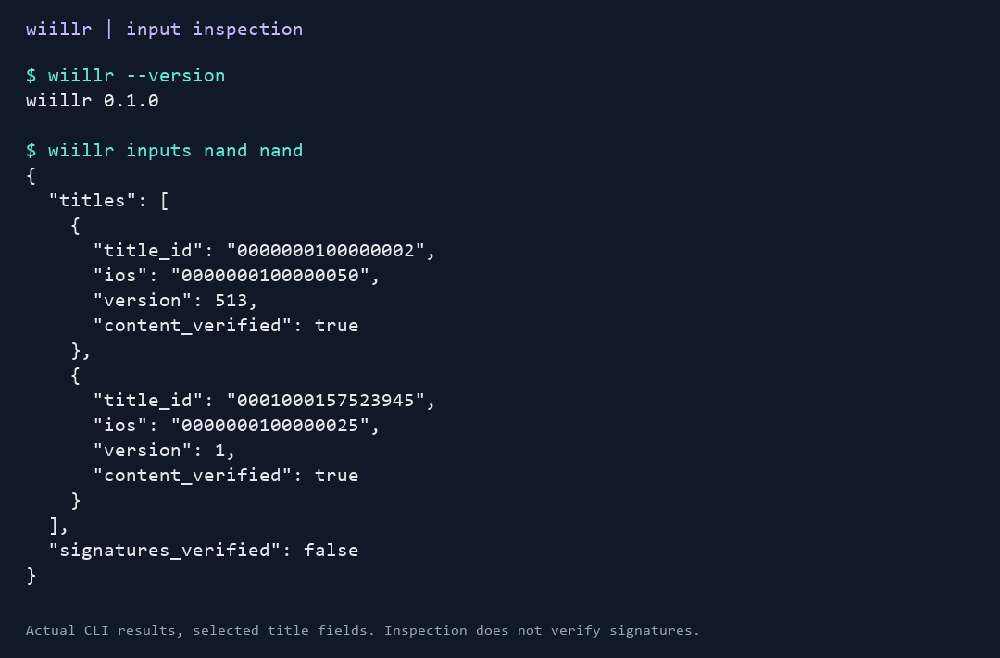

# wiillr developer tools

The developer bundle inspects original Wii inputs, runs bounded discovery and
prepares content-verified PowerPC compilations. It is separate from the Wii Menu
and Mega Man 9 player packages. It contains no game content, firmware, console
keys, prepared NAND, saved progress or generated guest catalog.



Use host Python 3.10 or newer. Add the bundle's `bin` directory to PATH, or run
`bin/wiillr` on Linux/macOS and `bin\wiillr.cmd` on Windows. The launchers select
`python3` or the Windows Python launcher; `WIILLR_PYTHON` can name another Python
executable. From a source checkout, use `python tools/wiillr.py` instead.

```text
wiillr --help
wiillr --version
wiillr inputs --help
wiillr discover --help
wiillr prepare --help
wiillr install-wad --help
wiillr install-ios --help
```

Arguments after the command go directly to the existing Python tool. Its output,
validation and exit status are preserved. Run a command's help for its complete
options. Paths containing spaces must be quoted by the calling shell.

## Inspect and discover

Inspection reads metadata without changing the input. Content hashes and title
identity checks do not establish signature verification or game compatibility.

```text
wiillr inputs wad "original game.wad"
wiillr inputs nand "original extracted NAND"
wiillr discover --nand "original extracted NAND" --nand-profile "owned NAND copy" --title 0000000100000002 --work-root "new discovery" --steps 10000000
```

`discover` uses bundled `wiillr-discover` by default. `--processor starlet`
selects `wiillr-starlet-discover`. An explicit `--executable` always takes
precedence. `--ppc-mode static` and `mixed-discovery` require a separately built
catalog-equipped executable; the tool-only bundle does not contain one.
Native IOS37/80 selection requires its explicit existing command option and a
matching rebuild; the default developer executable has no native IOS provider.
The example uses the IOS4 Startup Menu development target. Retail Menu/IOS80
and Mega Man 9/IOS37 need the matching provider and `--native-ios80` or
`--native-ios37` respectively. Original-IOS execution remains a separate
build-selected route.

Discovery uses a new work directory and an isolated writable NAND copy. Supply
the DSP ROM/coefficient pair if the selected executable requires them. Automated
runs default to no host audio; `--interactive` selects the existing visible,
audible development route. Discovery interpretation and counted native misses
are development evidence, not accepted native execution.

The original-IOS inspector and `wiillr-nand-setup` can also be invoked directly
from `bin` when included in the build. Their usage describes the required
original inputs. Installing or inspecting data does not prove original title
startup, and these tools do not synthesize missing hardware or firmware state.

## Prepare a static catalog

`prepare` uses bundled `dolrecomp` unless `--compiler` supplies another path.
It validates the retained DOL, discovery receipts, journals and code-page hashes,
then invokes the bundled overlay generator with preserved Broadway execution
namespaces. Its preparation receipt is not a runtime acceptance result.

```text
wiillr prepare --capture "verified discovery" --work-root "new prepared catalog"
wiillr prepare --dol "original.dol" --work-root "new DOL catalog"
wiillr prepare --catalog "verified prepared catalog" --work-root "new combined catalog"
```

Repeat `--capture`, `--dol` or `--catalog` as needed. A boot DOL alone does not
cover later loaded or relocated code. Keep the original inputs and verified
captures needed to reproduce those variants. Configure the native build with
`WIILLR_PPC_GENERATED_DIR` pointing to the resulting `generated` directory;
native qualification still requires zero interpreter execution and native misses.

## Install supplied content

These commands operate only on a stopped, marked, owned NAND copy. Preserve the
source inputs and keep native saves and licenses when updating an existing copy.
Use a new receipt path; existing receipts are not overwritten.

```text
wiillr install-wad --wad "original game.wad" --common-key "private common-key.bin" --profile "owned NAND copy" --receipt "new WAD receipt.json"
wiillr install-ios --source "original extracted NAND" --title 0000000100000025 --profile "owned NAND copy" --receipt "new IOS receipt.json"
```

WAD preparation uses the existing optional `cryptography` dependency, including
when showing that tool's help. Install the supplied requirements into your
chosen Python environment when using it:

```text
python -m pip install -r lib/wiillr/tools/requirements-inputs.txt
```

The offline `--offline-key-index 0` option, where needed, is explicit and recorded
separately from the original ticket. It does not rewrite the ticket's key index
or establish signature verification. The player package's native game/DLC import
is a separate user-facing path.

For a running development executable, the bundled `wii_control.py` provides the
existing loopback control protocol. Its text commands need only Python; PNG frame
export additionally uses Pillow. Use only the port of the process you own.

## Build and stage the bundle

Native CMake targets are `wiillr-discover`, `wiillr-starlet-discover` and
`wiillr-nand-setup`; `dolrecomp` comes from the shared PowerPC compiler build.
The developer bundle does not require `WIILLR_PPC_GENERATED_DIR` or a game
catalog. Native tools are staged when their executables exist in the supplied
build directory. Missing executables require an explicit path or a later build;
Python inspection remains available.

```text
python tools/developer_bundle.py --repo . --build-dir build --stage "new developer stage" --version 0.1.0
```

The Python API is
`stage_developer_bundle(repo: Path, build_dir: Path, stage: Path, version: str) -> list[Path]`.
It accepts a new or empty destination and never merges over an existing bundle.
It searches only `bin`, the build root, `Release` and `RelWithDebInfo` for the four
named native tools. Python sources live in `lib/wiillr/tools`, with the shared
overlay generator at its original relative path and the applicable source
licenses beside the payload. A `build-products.json` input-provider location
resolves the generator and license from `inputs_dir/deps/gc-wii-core`, so source
snapshots do not need a recursive submodule checkout. Without that metadata, staging uses
the checkout's `external/gc-wii-core`. Only those explicit provider source files
are read; the private catalog and genuine inputs are excluded.
The release packager adds each platform's native
runtime dependency closure and final notices before producing an archive.
Release packaging requires all four native tools; the staging helper also
supports a source-only bundle while builds are being prepared.

Keep keys, firmware, NAND, game content, captures, native saves and generated guest
code outside source control, including private repositories. Preserve build
identities and validate the resulting binaries separately on each release platform.
