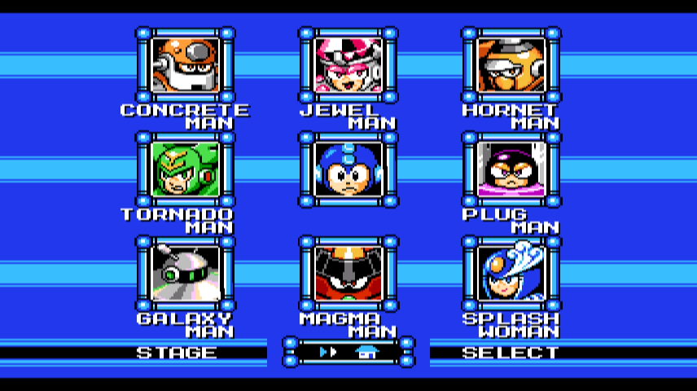

# Mega Man 9 Recomp

A separate desktop launcher for Mega Man 9 (USA), with optional DLC import,
adaptive display settings and game-specific mods.

## First launch

Extract the complete package and open **Mega Man 9**. Choose your own supported
USA game WAD and **Import game WAD**. Use **Add DLC** for an optional matching
DLC WAD, then launch. Import preserves the original ticket and metadata and
verifies decrypted content hashes. Unsupported boot revisions are rejected.
No game WAD, DLC, NAND or DSP firmware is included.

WAD decryption requires a separate common-key input. A source build can use
`WIILLR_COMMON_KEY` pointing to your 16-byte key file, or the private packaging
input `system/wii-common-key.bin`. Key material is never stored in Git. HLE
audio uses the firmware-free coefficient path.

Your managed NAND, licenses, native progress and launcher choices live in the
per-user **Mega Man 9** preferences directory. Updates reuse that directory.
`WIILLR_USER_DIR` selects an explicit location. Do not overwrite it with a fresh
profile or a test save.

## Settings and mods

Fresh display settings use **Fit to screen**. Original 4:3, 16:9 and 21:9 are
also available. Explicit saved choices persist. The internal-resolution setting
controls native GPU geometry independently of the bitmap artwork's detail.
The intro and menu layout support both Wii 4:3 and widescreen system settings.

**F1** opens in-session settings and pauses the game. **Resume** returns to the
same point and preserves a manually resized window. Configure keyboard and
gamepad mappings under **Controller**; keyboard HOME defaults to **A**.

The **Mods** page provides optional character switching and quick weapon
switching, both disabled by default:

- With Proto Man DLC installed, a short Select press swaps Mega Man and Proto
  Man when standing safely. Hold Select for two seconds for the original records
  screen. Each character retains separate health, weapon energy and selection
  during the session; lives, acquired weapons and mode remain shared.
- L1/R1, or keyboard Q/E, cycles acquired weapons. Remap these actions in
  Controller settings.

Restart the game after changing gameplay mods. Native saves retain the original
mode's character and helmetless choice and also load with character switching
disabled.

## Wii Menu relationship

This launcher starts Mega Man 9 directly. HOME's Wii Menu action returns to the
launcher when the original Menu is not installed. An installed supported original
Menu retains its normal handoff route. The separate [Wii Menu package](wii-menu.md)
has system controls and does not list Mega Man 9-specific mods.

A launcher option to start initially through Wii Menu is not included in this
release. Arbitrary Wii games and broad renderer/upscale performance claims are
outside its qualified scope.

See [building and releases](building.md) for all three desktop platforms.
Mega Man and its original assets belong to their respective rights holders.
