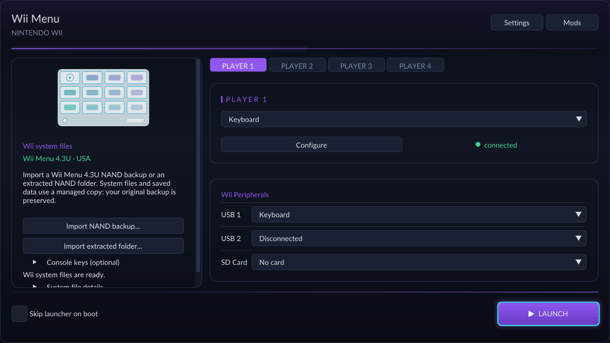
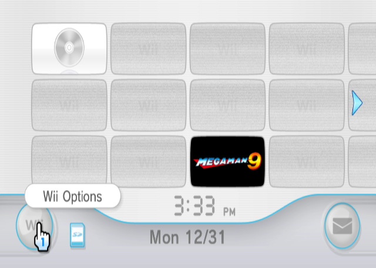

# Wii Menu Recomp

Run the original Wii Menu with a native desktop launcher, mouse pointing,
configurable Wii Remotes and image-backed Wii peripherals.

## First launch

1. Extract the complete package and open **Wii Menu**.
2. Choose **Import NAND backup** for a BootMii backup, or **Import extracted
   folder** for an already extracted NAND.
3. Supply your own **Wii Menu 4.3U (USA)** system files. A BootMii backup can use
   its embedded keys; **Console keys** accepts the matching `keys.bin` or
   128-byte OTP backup when needed. An extracted folder needs no separate key.
4. Wait for **Wii system files are ready**, then choose **Launch**.

Import verifies the supported Menu content and installed metadata before launch.
It creates a managed writable copy. Your source backup, saves and system settings
are preserved. Importing another system creates a separate profile rather than
merging over existing progress. Other Menu revisions are rejected explicitly.
No system files, games, NAND backups or console keys are included.

The native IOS80 provider does not require the original IOS80 executable.
Original IOS LLE is a separate development build and is not qualified by this
release's native-provider checks.

## Controls and peripherals

Use the mouse as the pointer, left click for A and right click for B. Keyboard
**A** is the default HOME binding; change it in **Settings → Controller**.
**F1** opens settings during play. Controller mappings and window geometry persist.

The launcher has separate Player 1–4 Wii Remote assignments. **Wii Peripherals**
below them provides two USB slots and one SD slot:

| Slot | Choices |
| --- | --- |
| USB 1 / USB 2 | Disconnected, host keyboard, raw mass-storage image |
| SD Card | No card, raw SD image |

USB 1 defaults to Keyboard. Typing through this peripheral is independent of
keyboard buttons assigned to a Wii Remote. Choose an existing formatted raw
image for storage; the launcher does not create or format images. New selections
start read only. Clear **Read only** to allow guest writes. **Eject** flushes and
detaches the selected image. Settings survive restart.

## Display, mods and channels

Fresh settings use widescreen and **Fit to screen**. **Mods** contains Wii system
options, including internal resolution; game-specific Mega Man 9 mods belong in
its [separate launcher](mega-man-9.md). Higher internal resolutions increase GPU
cost and do not create new detail in bitmap artwork.

An unconfigured network profile starts as wired Connection 1 with automatic
IP/DNS. Existing connection settings are preserved. Host IPv4 sockets and DNS
are available; AOSS, SSL, online WiiConnect24 and Nintendo service availability
are outside the release's qualified feature set.

Installed supported channels retain their original Menu entry and HOME return
flow. Wii Menu → Mega Man 9 → HOME → Wii Menu preserves the window and pointer.
This package does not install channel content for you or provide arbitrary Wii
title compatibility.

## Updates and building

Replace the application package while retaining your per-user preferences and
managed NAND. Do not copy a fresh template over existing native saves.
`WIILLR_USER_DIR` can select an explicit profile location.

See [building and releases](building.md) for Windows, Linux and macOS commands.
See [developer tools](developer-tools.md) for input inspection and native code
preparation. wiillr is independent software and is not affiliated with Nintendo.
